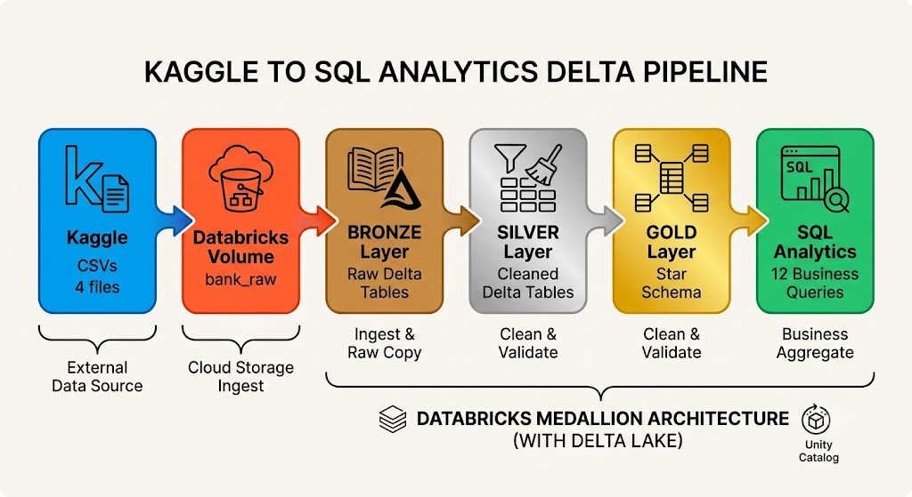
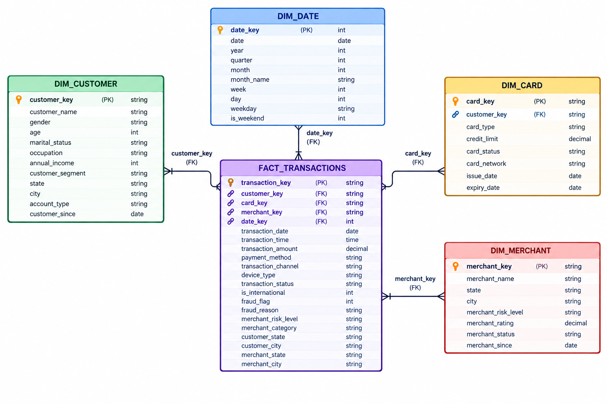

# 🏦 Financial Fraud Pipeline

End-to-end banking data pipeline using the Kaggle Indian Financial Fraud dataset. Ingests 250,000 raw transactions, stores them in AWS S3, cleans them through Bronze/Silver layers on Databricks, models them into a star schema in Gold, and answers 10 fraud analytics questions with SQL.

---

## 📌 Project Overview

This project simulates how a real bank processes daily transactions to detect fraud. It demonstrates the complete data engineering lifecycle:

1. **Ingest** raw CSVs from Kaggle
2. **Store** in AWS S3 (cloud data lake)
3. **Clean** and validate through Bronze → Silver on Databricks
4. **Model** into a proper star schema (Gold)
5. **Query** for fraud insights using SQL
6. **Version** every table change with Delta Lake time travel


---

## 🏗️ Architecture





**Flow:** Kaggle CSVs → Databricks Volume → Bronze (raw Delta tables) → Silver (cleaned Delta tables) → Gold (star schema) → SQL Analytics

---

## 🌟 Star Schema





| Table | Type | Rows | Purpose |
|-------|------|------|---------|
| `fact_transactions` | Fact | 250,000 | Transactions — measures + FKs |
| `dim_customer` | Dimension | 25,000 | Customer demographics |
| `dim_card` | Dimension | 32,457 | Card details |
| `dim_merchant` | Dimension | 500 | Merchant info |
| `dim_date` | Dimension | 1,326 | Calendar attributes (generated) |


---

## 🛠️ Tech Stack

| Layer | Tool |
|-------|------|
| **Storage** | Databricks Volumes (Unity Catalog), AWS S3 (learned) |
| **Compute** | Databricks Serverless |
| **Transform** | PySpark |
| **Table Format** | Delta Lake (ACID, time travel, schema evolution) |
| **Warehouse** | Star Schema (Kimball-style) |
| **Query** | Spark SQL |
| **Languages** | Python, SQL |
| **Version Control** | Git, GitHub |
| **IDE** | PyCharm |
| **Orchestration (planned)** | Apache Airflow |

---

## 📊 Dataset

**Source:** [Indian Financial Fraud Dataset on Kaggle](https://www.kaggle.com/datasets/jatinkhandelwal112/indian-financial-fraud-dataset)

| File | Rows | Purpose |
|------|------|---------|
| `Transaction_Data_250k.csv` | 250,000 | Fact table source |
| `Cards_Data.csv` | 32,457 | dim_card source |
| `Cusmtomer_data.csv` | 25,000 | dim_customer source |
| `merchant_table.csv` | 500 | dim_merchant source |

---

## 📁 Project Structure

```text
bank-transaction-360/
│
├── data/
│   ├── raw/                          # Kaggle CSVs (gitignored)
│   │   ├── .gitkeep
│   │   ├── Transaction_Data_250k.csv
│   │   ├── Cards_Data.csv
│   │   ├── Cusmtomer_data.csv
│   │   └── merchant_table.csv
│   └── processed/                    # Local processed data
│       └── .gitkeep
│
├── databricks_notebooks/             # Exported PySpark notebooks
│   ├── 01_bronze_ingest.ipynb
│   ├── 02a_silver_customers.ipynb
│   ├── 02b_silver_cards.ipynb
│   ├── 02c_silver_merchants.ipynb
│   ├── 02d_silver_transactions.ipynb
│   ├── 03a_dim_customer.ipynb
│   ├── 03b_dim_card.ipynb
│   ├── 03c_dim_merchant.ipynb
│   ├── 03d_dim_date.ipynb
│   ├── 03e_fact_transactions.ipynb
│   └── 04_analytics.ipynb
│
├── sql/
│   └── analytics_queries.sql         # 12 business queries
│
├── docs/
│    ── data_dictionary.md            # Schema reference
|__ images/   
│      |__architecture.jpg
├── .gitignore
├── README.md                         # This file
├── requirements.txt
├── inspect_data.py                   # Data profiling script
└── upload_to_s3.py                   # S3 upload script
```


---

## ⚙️ Setup Instructions

### Prerequisites

- **Databricks Free Edition** account (`databricks.com/learn/free-edition`)
- **PyCharm** (or any Python IDE)
- **Python 3.10+**
- **Git**

### Step-by-Step

**1. Clone the repo**

```bash
git clone https://github.com/your-username/bank-transaction-360.git
cd bank-transaction-360 
```

**2. Create virtual environment**

```bash
python -m venv venv
venv\Scripts\activate          # Windows
source venv/bin/activate       # Mac/Linux
```

**3. Install Dependencies**

```bash
pip install -r requirements.txt      # Mac/Linux
```

**4. Download dataset**

- Go to [Kaggle dataset](https://www.kaggle.com/datasets/jatinkhandelwal112/indian-financial-fraud-dataset)

-Download and place all 4 CSVs into data/raw/


**5. Inspect data**

```bash
python inspect_data.py
```


**6. Set up Databricks**

- Sign in to Databricks Free Edition

- Create a Volume named bank_raw at /Volumes/workspace/default/bank_raw

- Upload the 4 CSVs into the Volume


**7. Run the notebooks**


- 01_bronze_ingest → creates 4 Bronze tables

- 02a–02d_silver_* → creates 4 Silver tables

- 03a–03e_gold_* → creates dim + fact tables

- 04_analytics → runs all business queries


**8. Query the warehouse**

Use sql/analytics_queries.sql in any Databricks SQL cell.


## 🔄 Pipeline Steps

### 🥉 Bronze Layer — Raw Ingestion

**Notebook:** `01_bronze_ingest`
**Purpose:** Copy raw CSVs into Delta tables. No cleaning.

| Table | Rows | Source |
|-------|------|--------|
| `bronze_transactions` | 250,000 | Transaction_Data_250k.csv |
| `bronze_cards` | 32,457 | Cards_Data.csv |
| `bronze_customers` | 25,000 | Cusmtomer_data.csv |
| `bronze_merchants` | 500 | merchant_table.csv |

**Key Actions:**
- Read CSVs from Databricks Volume
- Add tracking columns: `_ingested_at`, `_source_file`
- Write as Delta tables
- Uses `_metadata.file_path` (UC-compatible) instead of `input_file_name()`

### 🥈 Silver Layer — Cleaning

**Notebooks:** `02a`, `02b`, `02c`, `02d`
**Purpose:** Clean, validate, standardize.

**Transformations applied:**
- Trim whitespace from string columns
- Rename to snake_case (`Transaction_ID` → `transaction_id`)
- Drop exact duplicates
- Drop null primary/foreign keys
- Cast types (`amount` → decimal, dates → date)
- Filter negative amounts
- Add `_silver_updated_at` audit column

### 🥇 Gold Layer — Star Schema

**Notebooks:** `03a` – `03e`
**Purpose:** Build the data warehouse model.

**Key Design:**
- **Surrogate keys:** `_key` suffix convention (e.g., `customer_key`)
- **date_key** as integer `yyyyMMdd` for fast joins
- **Fact partitioned** by `date_key`
- **dim_date generated** with year, quarter, month, weekday, is_weekend

---

## 📈 Business Analytics

**12 SQL queries** in `sql/analytics_queries.sql`:

| # | Question | Business Value |
|---|----------|----------------|
| 1 | Overall fraud baseline | Understand fraud scale |
| 2 | Fraud by merchant category | Tune monitoring per category |
| 3 | Fraud by customer state | Geographic controls |
| 4 | Fraud by card type | Card-tier risk models |
| 5 | Fraud by transaction channel | Channel-specific rules |
| 6 | Time-of-day patterns | Hour-based thresholds |
| 7 | International vs domestic | Cross-border risk |
| 8 | Fraud reasons breakdown | Focus for fraud ops |
| 9 | Top fraudulent merchants | Investigation targets |
| 10 | Month-over-month trend | Long-term monitoring |
| 11 | High-risk merchant validation | Data quality check |
| 12 | Customer segment × fraud | Segment-specific controls |

---

## 💡 Key Insights

**From actual query results on 250,000 transactions:**

| Insight | Number |
|---------|--------|
| **Overall fraud rate** | 5.39% (13,473 frauds) |
| **Total fraud amount** | ₹1,05,22,00,974 (~₹105 Cr) |
| **Avg fraud transaction** | ₹78,097 |
| **International fraud rate** | **19.69%** — 4x higher than domestic (4.63%) |
| **Peak fraud hour** | Midnight (hour 0) — 5.80% |
| **Highest fraud state** | Uttar Pradesh (1,016 frauds) |
| **Highest fraud category** | Hospital (₹11.3 Cr) |
| **Most flagged reason** | Expired card (2,470 occurrences) |
| **Costliest reason** | High amount vs credit limit (₹77.2 Cr) |
| **Top fraudulent merchant** | Max Healthcare, Durgapur (₹1 Cr) |

**🔑 Killer Finding:** International transactions have a **4.3x higher fraud rate** than domestic — a critical risk-control signal.


---

## 🧠 Design Decisions

### Why a denormalized fact table?

`fact_transactions` contains descriptive columns like `merchant_category`, `device_type`, `payment_method` directly (instead of separate dims).

**Tradeoff accepted:**
- ✅ Simpler queries (fewer joins)
- ✅ Modern columnar compression (Delta + zstd) makes storage negligible at this scale
- ⚠️ Deviates from strict Kimball star schema

**At 100M+ rows:** Split into `dim_payment_method`, `dim_device`, `dim_channel` for storage efficiency.

### Why Volumes instead of S3?

Databricks Free Edition serverless **blocks** `spark.conf.set("fs.s3a.*")`.

- **Learning path:** Used AWS S3 (Step 2) — proved S3 knowledge
- **Execution:** Switched to Volumes — works natively on serverless
- **Production:** Would use S3 + IAM roles (no credentials in code)

### Why `_metadata.file_path`?

Unity Catalog **blocks** `input_file_name()`. The UC-safe alternative is `col("_metadata.file_path")` — provides lineage without exposing physical paths.

---

## 📚 What I Learned

**Data Engineering Concepts:**
- ✅ Medallion Architecture (Bronze → Silver → Gold)
- ✅ Star Schema modeling (facts + dimensions)
- ✅ Surrogate keys vs natural keys
- ✅ Delta Lake ACID transactions + time travel
- ✅ Partitioning strategies for fact tables
- ✅ Unity Catalog constraints (`_metadata.file_path`)
- ✅ Serverless limitations (`spark.conf` restrictions)

**Tools:**
- ✅ PySpark for distributed transformation
- ✅ Databricks notebooks for interactive dev
- ✅ SQL for analytical queries
- ✅ Git for version control
- ✅ AWS S3 basics (access keys, bucket creation)
- ✅ Databricks Volumes (Unity Catalog storage)

**Soft Skills:**
- ✅ Debugging pipeline errors (schema drift, column resolution)
- ✅ Making pragmatic tradeoffs (denormalized fact)
- ✅ Documenting design decisions
- ✅ Extracting business insights from data

---

## 🔮 Future Improvements

- [ ] **Orchestrate with Apache Airflow** — daily DAG: bronze → silver → gold
- [ ] **Refactor fact table** — split descriptive columns into dims
- [ ] **Add data quality checks** — Great Expectations or Delta Live Tables
- [ ] **Build dashboard** — Databricks SQL dashboard for fraud monitoring
- [ ] **CI/CD pipeline** — GitHub Actions to run tests
- [ ] **Switch to S3 + IAM roles** — production-grade storage
- [ ] **Add streaming** — Kafka + Structured Streaming for real-time fraud
- [ ] **ML layer** — train fraud detection model on Gold data

---

## 📜 License

MIT — free to use for learning.

---

## 🙏 Acknowledgements

- Dataset: Kaggle (Indian Financial Fraud Dataset)
- Tools: Databricks, Apache Spark, Delta Lake
- Inspiration: Real-world banking fraud detection pipelines

---

**⭐ If this project helped you learn, give it a star!**
